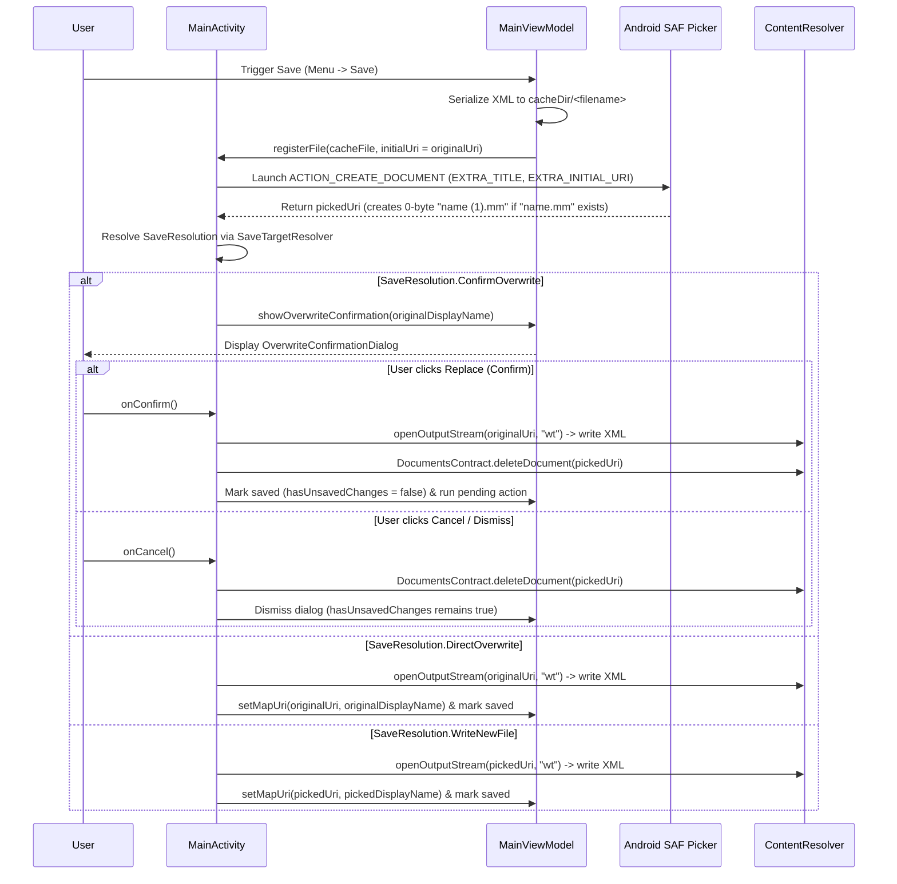

# Contract: File Save & Overwrite Flow (`011-replace-existing-file-save`)

**Date**: 2026-10-16  
**Branch**: `011-replace-existing-file-save`  
**Spec**: [spec.md](../spec.md)

## 1. Component Boundaries & Interfaces

### 1.1 `:data` Module — `NodeManager`

```kotlin
// Updates to NodeManager (and NodeManagerContract where applicable):
fun getMapUri(): Uri?
fun getMindmapFileName(debug: Boolean = false): String?
fun setMapUri(data: Uri?, displayName: String? = null)
```

- **Preconditions**:
  - When `createNewMindmap()` is invoked, `currentMindMapUri` and `currentMindMapDisplayName` MUST both be reset to `null`.
- **Postconditions**:
  - `getMindmapFileName()` returns `currentMindMapDisplayName` if non-blank; otherwise extracts the last path segment from `currentMindMapUri?.path` (stripping any SAF storage prefix such as `primary:`).

---

### 1.2 `:app` Module — `FileRegister` & `MainViewModel`

```kotlin
interface FileRegister {
    fun registerFile(file: File, initialUri: Uri? = null)
}
```

#### `MainViewModel` Save Lifecycle Methods
- `fun setMapUri(data: Uri?, displayName: String? = null)`
  - Updates `nodeManager.setMapUri(data, displayName)`.
- `fun getMapUri(): Uri?`
  - Returns `nodeManager.getMapUri()`.
- `fun getSaveFilename(): String`
  - If editing an existing user file (`getMapUri()?.scheme != "android.resource"` and `getMindmapFileName()` is non-blank), returns the exact existing filename (ensuring `.mm` extension).
  - Otherwise derives a sanitized `<root_title>.mm` filename from the root node text.
- `fun launchSaveFile()`
  - Serializes the mindmap to `cacheDir/<getSaveFilename()>` and calls `fileRegister?.registerFile(file, initialUri = getMapUri())`.
- `fun showOverwriteConfirmation(fileName: String, onConfirm: () -> Unit, onCancel: () -> Unit)`
  - Emits `DialogType.OverwriteConfirmation(fileName, onConfirm, onCancel)` into `uiState.dialogType`.

---

### 1.3 `:app` Module — `MainActivity` & System File Picker (`ACTION_CREATE_DOCUMENT`)


