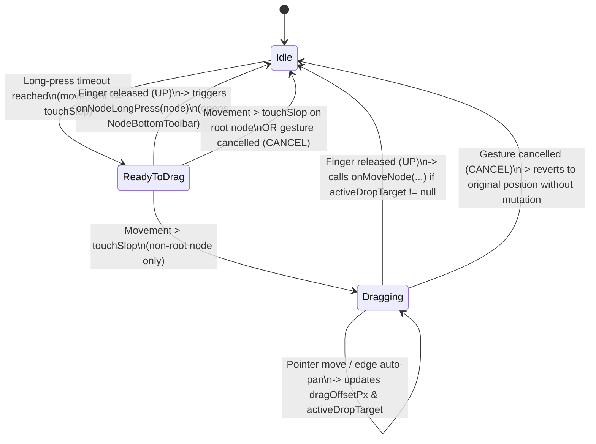

# Data Model: 2D Canvas Drag & Drop and Long-Press Release Toolbar

**Feature**: `014-nodelist-drag-drop`
**Date**: 2026-04-12

## 1. Domain Entities (`:data` module)

### `Node` (`data/src/main/java/fr/julien/quievreux/droidplane2/data/model/Node.kt`)
No schema changes are required on `Node`. The existing fields support full 2D tree reorganization:
- `id: String` — Unique Freeplane node identifier (e.g. `ID_123456`).
- `parentNode: Node?` — Reference to the parent `Node` (`null` only for the root node).
- `childNodes: MutableList<Node>` — Ordered mutable list of direct child nodes.
- `position: String?` — `"left"` or `"right"` for direct children of the root node; `null` for root and deeper descendants.
- `isFolded: Boolean` — Whether the node's children are collapsed in the mind map.

### Domain Operation: `NodeManager.moveNode`
Moves a non-root node `draggedNodeId` to a new or existing parent `targetParentId`, optionally positioning it relative to a sibling `targetSiblingId` and setting its root branch side `targetPosition`:

```kotlin
fun moveNode(
    draggedNodeId: String,
    targetParentId: String,
    targetSiblingId: String? = null,
    insertAfter: Boolean = true,
    targetPosition: String? = null,
): Boolean
```

#### Domain Invariants
1. **Non-Root Dragged Node**: `draggedNode` MUST exist in `_allNodes` and MUST have `draggedNode.parentNode != null` (the root node cannot be moved).
2. **Valid Target Parent**: `targetParent` MUST exist in `_allNodes`.
3. **Cycle & Self-Drop Prevention (`FR-012`)**:
   - `draggedNodeId != targetParentId`
   - `targetParent` MUST NOT be a descendant of `draggedNode` (walking `targetParent.parentNode` up to `rootNode` never encounters `draggedNodeId`).
4. **Valid Target Sibling (when `targetSiblingId != null`)**:
   - `targetSiblingId != draggedNodeId`
   - `targetParent.childNodes` MUST contain a node with `id == targetSiblingId`.
5. **Branch Position Normalization (`FR-006`)**:
   - When `targetParent.parentNode == null` (root node): `effectivePosition = targetPosition ?: draggedNode.position ?: "right"`.
   - When `targetParent.parentNode != null` (non-root node): `effectivePosition = null`.
6. **No-Op Detection**:
   - If `oldParent.id == targetParentId`, `effectivePosition == draggedNode.position`, and the computed target insertion index in `targetParent.childNodes` equals `oldIndex`, `moveNode` MUST return `false` without modifying `childNodes` or incrementing state.
7. **Parent Unfolding (`FR-006`)**:
   - If `targetParent.isFolded` is `true`, `targetParent.isFolded` is set to `false` upon attaching `draggedNode`private .
8. **Tree & Index Consistency**:
   - Both `oldParent` and `targetParent` are propagated to `rootNode` via `propagateUpdatedParentToRoot`, and `_allNodes` / `mindmapIndexes` remain synchronized with no duplicate or lost nodes.

---

## 2. UI State Models (`:app` module — `ui/mindmap`)

### `CanvasDragPhase` (`MindMapCanvasDragState.kt`)
Represents the mutually exclusive lifecycle phases of a long-press / drag gesture on a `MindMapNodeCard`:

```kotlin
enum class CanvasDragPhase {
    /** No active long-press or drag interaction. */
    Idle,

    /**
     * Finger has held stationary on a node card past the long-press timeout without exceeding touch slop.
     * - If the node is non-root, the card shows elevated "ready to drag" visual feedback.
     * - The NodeBottomToolbar is NOT shown while in this state (FR-001).
     * - Lifting the finger in this state triggers `onNodeLongPress(node)` on release (FR-002).
     * - Moving the finger past touch slop on a non-root node transitions to [Dragging] (FR-004).
     */
    ReadyToDrag,

    /**
     * User is actively dragging a non-root node across the 2D canvas.
     * - `onNodeLongPress` is suppressed for the remainder of the gesture (FR-003).
     * - Releasing the finger in this state commits `onMoveNode` if [activeDropTarget] is non-null,
     *   then resets to [Idle] (FR-006, FR-007).
     */
    Dragging,
}
```

### `DropZoneType` (`MindMapCanvasDragState.kt`)
Represents the Freeplane-style relative drop zone on a target node `T` (`Option A` from `/speckit-clarify`):

```kotlin
enum class DropZoneType {
    /** Top 25% of a non-root target node T -> insert as sibling immediately before T. */
    BEFORE_SIBLING,

    /** Middle 50% of a non-root target node T (or 100% of root node) -> attach as last child of T. */
    AS_CHILD,

    /** Bottom 25% of a non-root target node T -> insert as sibling immediately after T. */
    AFTER_SIBLING,
}
```

### `CanvasDropTarget` (`MindMapCanvasDragState.kt`)
Describes the resolved drop target under the dragged node on the 2D canvas:

```kotlin
data class CanvasDropTarget(
    /** The visual node card currently hovered by the dragged node. */
    val hoveredNodeId: String,
    /** The drop zone active on [hoveredNodeId] (Top = BEFORE_SIBLING, Center = AS_CHILD, Bottom = AFTER_SIBLING). */
    val zoneType: DropZoneType,
    /** ID of the parent node that will receive the dragged node on drop. */
    val targetParentId: String,
    /** ID of the reference sibling node when [zoneType] is BEFORE_SIBLING or AFTER_SIBLING; null when AS_CHILD. */
    val targetSiblingId: String?,
    /** True when inserting after [targetSiblingId] (or appending as last child); false when inserting before [targetSiblingId]. */
    val insertAfter: Boolean,
    /** Branch side ("left" or "right") when [targetParentId] is the root node; null otherwise. */
    val targetPosition: String?,
)
```

### `MindMapCanvasDragState` (`MindMapCanvasDragState.kt`)
State holder hoisted in `MindMapCanvasScreen` to coordinate gesture phases, 2D drag offsets, descendant cycle filtering, and drop target resolution:

| Property | Type | Description |
|----------|------|-------------|
| `phase` | `CanvasDragPhase` | Current gesture lifecycle phase (`Idle`, `ReadyToDrag`, `Dragging`). |
| `activeNodeId` | `String?` | ID of the node currently in `ReadyToDrag` or `Dragging`. |
| `isActiveNodeRoot` | `Boolean` | Whether `activeNodeId` is the root node (root supports long-press release toolbar, but cannot enter `Dragging`). |
| `draggedSubtreeIds` | `Set<String>` | Set containing `activeNodeId` and all of its descendant node IDs, used to reject self/descendant drops (`FR-012`). |
| `dragOffsetPx` | `Offset` | 2D translation offset `(dx, dy)` in unscaled canvas pixel coordinates from the node's initial `MindMapNodeLayout` center. |
| `pointerViewportPx` | `Offset?` | Current pointer position in viewport screen coordinates, used for viewport edge auto-panning (`FR-010`). |
| `activeDropTarget` | `CanvasDropTarget?` | Currently highlighted valid drop target under the dragged node, or `null` if over empty canvas / invalid target. |

### State Transitions


