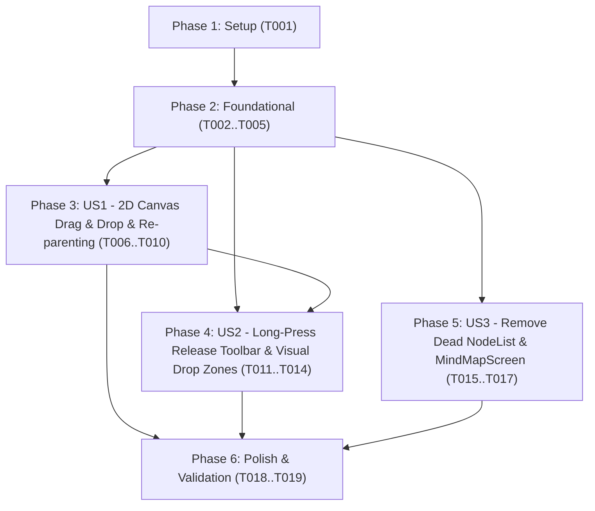

---

description: "Task list for 2D Canvas Drag & Drop, Long-Press Release Toolbar, and Legacy NodeList Removal"
---

# Tasks: 2D Canvas Drag & Drop, Long-Press Release Toolbar, and Legacy `NodeList` Removal

**Input**: Design documents from `/specs/014-nodelist-drag-drop/`
**Prerequisites**: [plan.md](file:///Users/julienquievreux/Documents/dev_android/perso/letroll/droidplane/specs/014-nodelist-drag-drop/plan.md) (required), [spec.md](file:///Users/julienquievreux/Documents/dev_android/perso/letroll/droidplane/specs/014-nodelist-drag-drop/spec.md) (required for user stories), [research.md](file:///Users/julienquievreux/Documents/dev_android/perso/letroll/droidplane/specs/014-nodelist-drag-drop/research.md), [data-model.md](file:///Users/julienquievreux/Documents/dev_android/perso/letroll/droidplane/specs/014-nodelist-drag-drop/data-model.md), [contracts/ui-contracts.md](file:///Users/julienquievreux/Documents/dev_android/perso/letroll/droidplane/specs/014-nodelist-drag-drop/contracts/ui-contracts.md)

**Tests**: Included per project Constitution (Principle V: Verification & Testing Discipline) and user global rules (`kotlin.test` prioritized for unit tests; `@Preview` for all Jetpack Compose composables).

**Organization**: Tasks are grouped by user story (`US1`, `US2`, `US3`) to enable independent implementation and testing of each story.

## Format: `[ID] [P?] [Story] Description`

- **[P]**: Can run in parallel (different files, no dependencies)
- **[Story]**: Which user story this task belongs to (e.g., `US1`, `US2`, `US3`)
- Exact file paths are included in every task description

---

## Phase 1: Setup (Shared Infrastructure)

**Purpose**: Inspect existing canvas layout coordinates (`MindMapLayoutEngine`) and `:data` tree mutation helpers before adding foundational domain contracts.

- [X] T001 Verify `MindMapNodeLayout` coordinate bounds (`x`, `y`, `width`, `height`, `isRoot`) in `app/src/main/java/fr/julien/quievreux/droidplane2/ui/mindmap/MindMapLayoutEngine.kt` and existing `reorderChildNode` helper in `data/src/main/java/fr/julien/quievreux/droidplane2/data/NodeManager.kt`

---

## Phase 2: Foundational (Blocking Prerequisites)

**Purpose**: Core `:data` domain operation (`NodeManager.moveNode`) and `:app` 2D canvas drag state & hit-testing model (`MindMapCanvasDragState`) that MUST be complete before User Story UI wiring.

**⚠️ CRITICAL**: No user story UI work can begin until this phase is complete.

- [X] T002 Declare `moveNode(draggedNodeId: String, targetParentId: String, targetSiblingId: String? = null, insertAfter: Boolean = true, targetPosition: String? = null): Boolean` in `data/src/main/java/fr/julien/quievreux/droidplane2/data/NodeManagerContract.kt`
- [X] T003 Implement `moveNode` in `data/src/main/java/fr/julien/quievreux/droidplane2/data/NodeManager.kt` enforcing all domain invariants from `data-model.md`: non-root `draggedNode` (`draggedNode.parentNode != null`), valid `targetParent`, self & cycle prevention (`draggedNodeId != targetParentId` and `targetParent` is not a descendant of `draggedNode`), sibling validation (`targetSiblingId != draggedNodeId` and exists in `targetParent.childNodes`), branch position normalization (`effectivePosition = targetPosition ?: draggedNode.position ?: "right"` when `targetParent.parentNode == null`, else `null`), no-op detection, automatic parent unfolding (`if (targetParent.isFolded) targetParent.isFolded = false`), and `propagateUpdatedParentToRoot` for both `oldParent` and `targetParent`
- [X] T004 [P] Add `kotlin.test` unit tests for `NodeManager.moveNode` (sibling reorder before/after, cross-parent re-parenting, root left/right `position` switching, non-root `position = null` clearing, folded parent auto-unfold, cycle/self-drop rejection, root drag rejection, no-op return `false`, and `.mm` serialization round-trip) in `data/src/test/java/fr/julien/quievreux/droidplane2/data/NodeManagerTest.kt`
- [X] T005 [P] Create `CanvasDragPhase` (`Idle`, `ReadyToDrag`, `Dragging`), `DropZoneType` (`BEFORE_SIBLING`, `AS_CHILD`, `AFTER_SIBLING`), `CanvasDropTarget`, `collectSubtreeIds`, `resolveCanvasDropTarget` (Top 25% `relY < 0.25f` -> `BEFORE_SIBLING`, Bottom 25% `relY > 0.75f` -> `AFTER_SIBLING`, Center 50% `0.25f..0.75f` -> `AS_CHILD`, and Root node `isRoot == true` -> `AS_CHILD` with `targetPosition = if (probeCanvasPos.x < hovered.x) "left" else "right"`), and `MindMapCanvasDragState` / `rememberMindMapCanvasDragState` in `app/src/main/java/fr/julien/quievreux/droidplane2/ui/mindmap/MindMapCanvasDragState.kt`

**Checkpoint**: Foundation ready — `:data` tree move/re-parenting and `:app` 2D drop-zone hit-testing models are in place.

---

## Phase 3: User Story 1 - Reorder and Re-parent Nodes via 2D Drag and Drop on the Canvas (Priority: P1) 🎯 MVP

**Goal**: Enable users to drag any non-root node across `MindMapCanvasScreen` to reorder it among siblings (`Top`/`Bottom` zones), re-parent it onto another node (`Center` zone, unfolding if collapsed), or switch its root branch side (`"left"` / `"right"`), committing once on drop (`FR-001`, `FR-004`, `FR-006`, `FR-007`, `FR-008`).

**Independent Test**: Open a mindmap on `MindMapCanvasScreen`, long-press and drag a child node above/below a sibling or onto the center of another node (or across the root node left/right), release it, and verify that the canvas immediately updates the hierarchy, branch side, and sibling order and marks the mindmap as having unsaved changes.

### Tests for User Story 1 ⚠️

- [X] T006 [P] [US1] Create `kotlin.test` unit tests in `app/src/test/java/fr/julien/quievreux/droidplane2/ui/mindmap/MindMapCanvasDragStateTest.kt` covering `resolveCanvasDropTarget` (`BEFORE_SIBLING` top 25%, `AS_CHILD` middle 50%, `AFTER_SIBLING` bottom 25%, root left/right `targetPosition`), `collectSubtreeIds` cycle exclusion, and `MindMapCanvasDragState` commit-on-release (`onMoveNode` invoked once on valid drop)
- [X] T007 [P] [US1] Add `kotlin.test` unit tests for `MainViewModel.onMoveNode` (verifying `nodeManager.moveNode` invocation, `treeVersion` increment, `collapsedNodeIds` removal of `targetParentId`, `hasUnsavedChanges = true`, and no-op handling when `moveNode` returns `false`) in `app/src/test/java/fr/julien/quievreux/droidplane2/MainViewModelTest.kt`

### Implementation for User Story 1

- [X] T008 [US1] Implement `onMoveNode(draggedNodeId: String, targetParentId: String, targetSiblingId: String? = null, insertAfter: Boolean = true, targetPosition: String? = null)` in `app/src/main/java/fr/julien/quievreux/droidplane2/MainViewModel.kt` to call `nodeManager.moveNode`, set `hasUnsavedChanges = true`, remove `targetParentId` from `collapsedNodeIds`, and increment `treeVersion`
- [X] T009 [US1] Update `MindMapCanvasScreen` in `app/src/main/java/fr/julien/quievreux/droidplane2/ui/mindmap/MindMapCanvasScreen.kt` to accept `onMoveNode`, instantiate `rememberMindMapCanvasDragState`, apply 2D `dragOffsetPx` and elevated `zIndex` to the actively dragged `MindMapNodeCard`, and run a frame-synced viewport edge auto-panning loop (`56.dp` edge threshold) while `dragState.phase == CanvasDragPhase.Dragging`
- [X] T010 [US1] Wire `onMoveNode = viewModel::onMoveNode` into `MindMapCanvasScreen` in `app/src/main/java/fr/julien/quievreux/droidplane2/MainActivity.kt`

**Checkpoint**: User Story 1 is functional — nodes can be dragged and dropped across the 2D canvas to reorder siblings, re-parent subtrees, and switch left/right root branches.

---

## Phase 4: User Story 2 - Clear Visual Feedback and Gesture Coexistence on MindMapNodeCard (Priority: P2)

**Goal**: Ensure holding a `MindMapNodeCard` past the long-press timeout enters `ReadyToDrag` (elevated visual state) **without** opening `NodeBottomToolbar` while the finger is still down; releasing without moving opens `NodeBottomToolbar` on finger release (`FR-002`); moving past touch slop drags the card and renders `Top` / `Center` / `Bottom` drop zone indicators on hovered target cards while preserving single-tap, double-tap, fold toggle, and background canvas pan/zoom (`FR-003`, `FR-005`).

**Independent Test**: Press and hold a `MindMapNodeCard` without lifting the finger and verify `NodeBottomToolbar` does NOT appear during the hold; release without moving and verify `NodeBottomToolbar` opens on release; long-press and move to verify elevated card visuals, `BEFORE_SIBLING` / `AS_CHILD` / `AFTER_SIBLING` drop zone highlights, and no toolbar popup; single-tap and double-tap to verify no regressions.

### Tests for User Story 2 ⚠️

- [X] T011 [P] [US2] Add `kotlin.test` unit tests in `app/src/test/java/fr/julien/quievreux/droidplane2/ui/mindmap/MindMapCanvasDragStateTest.kt` for stationary long-press release (`Idle` -> `ReadyToDrag` -> `onRelease` triggers `onNodeLongPress` and never calls `onMoveNode`), drag cancellation (`onCancel` resets to `Idle` without calling `onNodeLongPress` or `onMoveNode`), and root node long-press release vs drag prevention
- [X] T012 [P] [US2] Create instrumented Compose UI tests in `app/src/androidTest/java/fr/julien/quievreux/droidplane2/ui/mindmap/MindMapCanvasScreenTest.kt` verifying: (1) holding down a `MindMapNodeCard` past long-press timeout does NOT invoke `onNodeLongPress` while the pointer is still down, (2) releasing the pointer after a stationary long-press invokes `onNodeLongPress` once on release, (3) long-pressing and dragging a non-root node across another node invokes `onMoveNode` on release without invoking `onNodeLongPress`, and (4) single-tap (`onNodeClick`) works normally

### Implementation for User Story 2

- [X] T013 [US2] Replace `.combinedClickable` in `app/src/main/java/fr/julien/quievreux/droidplane2/ui/mindmap/MindMapNodeCard.kt` with a custom `pointerInput` (`awaitEachGesture`) gesture detector that disambiguates single-tap (`onNodeClick`), double-tap (`onNodeDoubleClick`), stationary long-press release (`onNodeLongPress` fired only on `UP` while in `ReadyToDrag`), and 2D drag (`onDragMove` / `onDragEnd` / `onDragCancel` consuming pointer changes so background `detectTransformGestures` does not pan during node drag)
- [X] T014 [US2] Add visual elevation (`isDraggingOrReady` shadow/scale/alpha) and Freeplane-style target drop zone visual indicators (`activeDropZone: DropZoneType?` rendering top insertion bar for `BEFORE_SIBLING`, bottom insertion bar for `AFTER_SIBLING`, and container border/tint highlight for `AS_CHILD` with left/right root side indication) plus `@Preview` functions in `app/src/main/java/fr/julien/quievreux/droidplane2/ui/mindmap/MindMapNodeCard.kt` and `app/src/main/java/fr/julien/quievreux/droidplane2/ui/mindmap/MindMapCanvasScreen.kt`

**Checkpoint**: User Stories 1 AND 2 work seamlessly — `NodeBottomToolbar` opens strictly on finger release after a stationary long-press, and 2D drag-and-drop shows clear visual feedback without gesture conflicts.

---

## Phase 5: User Story 3 - Cleanup of Obsolete List View Components (Priority: P3)

**Goal**: Remove unused legacy list-view components and their obsolete test files (`NodeList.kt`, `MindMapScreen.kt`, `NodeListDragState.kt`, `NodeListTest.kt`, `NodeListDragStateTest.kt`) so no dead list-view code remains in `:app` (`FR-009`).

**Independent Test**: Confirm all 5 obsolete files are deleted, no references to `NodeList` or `MindMapScreen` remain in `app/src/` or `data/src/`, and `./gradlew testDebugUnitTest assembleDebug assembleDebugAndroidTest` succeeds cleanly.

### Implementation for User Story 3

- [X] T015 [P] [US3] Delete obsolete list-view production files `app/src/main/java/fr/julien/quievreux/droidplane2/ui/components/NodeList.kt`, `app/src/main/java/fr/julien/quievreux/droidplane2/ui/components/MindMapScreen.kt`, and `app/src/main/java/fr/julien/quievreux/droidplane2/ui/components/NodeListDragState.kt`
- [X] T016 [P] [US3] Delete obsolete list-view test files `app/src/androidTest/java/fr/julien/quievreux/droidplane2/ui/components/NodeListTest.kt` and `app/src/test/java/fr/julien/quievreux/droidplane2/ui/components/NodeListDragStateTest.kt`
- [X] T017 [US3] Clean up any remaining unused list-only helper or comment references in `app/src/main/java/fr/julien/quievreux/droidplane2/MainViewModel.kt` and `app/src/main/java/fr/julien/quievreux/droidplane2/ui/components/NodeIconsRow.kt`

**Checkpoint**: All obsolete `NodeList` and `MindMapScreen` files are removed and the project compiles cleanly.

---

## Phase 6: Polish & Cross-Cutting Concerns

**Purpose**: Final validation across `:data` and `:app` modules, unit tests, and quickstart verification.

- [X] T018 Verify `@Preview` annotations on all modified/created composables in `app/src/main/java/fr/julien/quievreux/droidplane2/ui/mindmap/MindMapNodeCard.kt` and `app/src/main/java/fr/julien/quievreux/droidplane2/ui/mindmap/MindMapCanvasScreen.kt`
- [X] T019 Run full unit test suite and debug builds (`./gradlew :data:testDebugUnitTest :app:testDebugUnitTest assembleDebug assembleDebugAndroidTest`) per `specs/014-nodelist-drag-drop/quickstart.md`

---

## Dependencies & Execution Order

### Phase Dependencies

- **Setup (Phase 1)**: No dependencies — can start immediately.
- **Foundational (Phase 2)**: Depends on Setup (`T001`) — BLOCKS all user stories (`T002` -> `T003` -> `T004`, and `T005` in parallel).
- **User Story 1 (Phase 3 - P1 🎯 MVP)**: Depends on Foundational (`T003`, `T005`).
- **User Story 2 (Phase 4 - P2)**: Depends on Foundational (`T005`) and integrates with `MindMapCanvasScreen` (`T009`).
- **User Story 3 (Phase 5 - P3)**: Independent of `US1`/`US2` canvas changes; can execute in parallel with or immediately after `US1`/`US2`.
- **Polish (Phase 6)**: Depends on Phases 3, 4, and 5 completion.

### User Story Dependencies



### Parallel Opportunities

- **Phase 2 (Foundational)**: `T004` (`NodeManagerTest.kt`) and `T005` (`MindMapCanvasDragState.kt`) can run in parallel once `T002`/`T003` are complete.
- **Phase 3 (US1)**: `T006` (`MindMapCanvasDragStateTest.kt`) and `T007` (`MainViewModelTest.kt`) can run in parallel.
- **Phase 4 (US2)**: `T011` (`MindMapCanvasDragStateTest.kt`) and `T012` (`MindMapCanvasScreenTest.kt`) can run in parallel.
- **Phase 5 (US3)**: `T015` (delete production files) and `T016` (delete test files) can run in parallel.

---

## Parallel Example: Foundational + User Story 1

```bash
# In Phase 2, after T003 (NodeManager.moveNode) is implemented:
Task T004: "Add kotlin.test unit tests for NodeManager.moveNode in data/src/test/java/fr/julien/quievreux/droidplane2/data/NodeManagerTest.kt"
Task T005: "Create CanvasDragPhase, DropZoneType, CanvasDropTarget, and MindMapCanvasDragState in app/src/main/java/fr/julien/quievreux/droidplane2/ui/mindmap/MindMapCanvasDragState.kt"

# In Phase 3 (US1), launch unit test tasks in parallel:
Task T006: "Create kotlin.test unit tests in app/src/test/java/fr/julien/quievreux/droidplane2/ui/mindmap/MindMapCanvasDragStateTest.kt"
Task T007: "Add kotlin.test unit tests for MainViewModel.onMoveNode in app/src/test/java/fr/julien/quievreux/droidplane2/ui/MainViewModelTest.kt"
```

---

## Implementation Strategy

### MVP First (User Story 1 + User Story 2 Gesture Core)

1. Complete **Phase 1: Setup** (`T001`) and **Phase 2: Foundational** (`T002`–`T005`).
2. Complete **Phase 3: User Story 1** (`T006`–`T010`) and **Phase 4: User Story 2** (`T011`–`T014`) so `MindMapNodeCard` and `MindMapCanvasScreen` support both long-press release toolbar (`NodeBottomToolbar` only on finger release) and 2D drag-and-drop reorganization.
3. Complete **Phase 5: User Story 3** (`T015`–`T017`) to remove unused `NodeList` and `MindMapScreen` files.
4. Run **Phase 6: Polish & Validation** (`T018`–`T019`) to verify all unit tests and builds pass.
