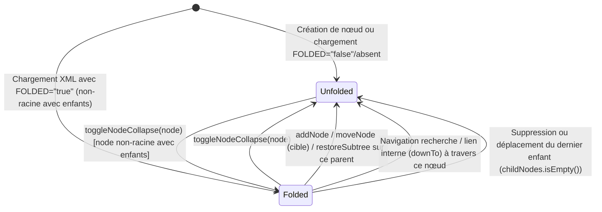

# Data Model: Support de l'état réduit (plié / déplié) des nœuds Freeplane (`016-node-folded-state`)

## 1. Domain Entity: `Node` (`:data`)

**Fichier** : `data/src/commonMain/kotlin/fr/julien/quievreux/droidplane2/data/model/Node.kt`

| Propriété | Type | Défaut | Attribut XML Freeplane | Règles de validation / Invariants |
|-----------|------|--------|------------------------|-----------------------------------|
| `id` | `String` | requis | `ID` | Identifiant unique du nœud dans la carte mentale (ex. `ID_1478696366`). |
| `parentNode` | `Node?` | `null` | Implicite (imbrication `<node>`) | `null` uniquement pour le nœud racine. |
| `childNodes` | `MutableList<Node>` | `mutableListOf()` | Enfants `<node>` | Liste ordonnée des nœuds enfants directs. |
| `isFolded` | `Boolean` | `false` | `FOLDED="true"` / `FOLDED="false"` | - Toujours `false` pour le nœud racine (`parentNode == null`). - Effectif uniquement si `childNodes.isNotEmpty()`. - Sérialisé en XML sous la forme `FOLDED="true"` uniquement si `isFolded == true && parentNode != null && childNodes.isNotEmpty()`. |

---

## 2. Presentation State: `MainUiState` (`:app`)

**Fichier** : `app/src/commonMain/kotlin/fr/julien/quievreux/droidplane2/MainUiState.kt`

| Propriété | Type | Défaut | Rôle et Synchronisation |
|-----------|------|--------|-------------------------|
| `collapsedNodeIds` | `Set<String>` | `emptySet()` | Ensemble immuable des `id` de nœuds actuellement réduits sur le canevas 2D. - **Initialisation** : Peuplé à la fin de `loadMindMap` avec tous les `node.id` de l'arbre où `node.parentNode != null && node.isFolded && node.childNodes.isNotEmpty()`. - **Synchronisation** : Toute modification de `collapsedNodeIds` (via `toggleNodeCollapse`, `addNode`, `onDeleteNode`, `onUndoDelete`, `onMoveNode`, `downTo`) met également à jour `node.isFolded` dans `NodeManager`. |
| `selectedNodeId` | `String?` | `null` | Identifiant du nœud actuellement sélectionné sur le canevas (mis à jour lors de la navigation par recherche ou lien interne après dépliage des ancêtres). |
| `treeVersion` | `Long` | `0L` | Compteur monotone incrémenté lors des mutations d'arbre pour invalider le cache de mise en page du canevas. |

---

## 3. Transitions d'État (`isFolded` & `collapsedNodeIds`)

