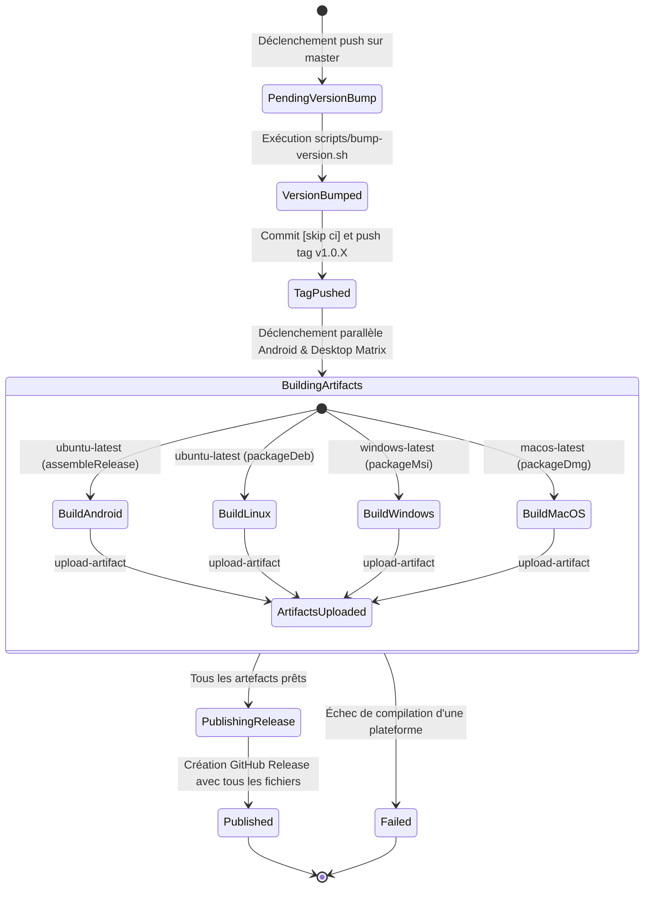

# Phase 1: Data Model & Release Artifact Schema

**Feature**: `018-desktop-multiplatform-releases`  
**Date**: 2026-11-11  

---

## 1. Entités Conceptuelles

### Release (Publication de version)
Représente la publication officielle d'une version de Droidplane sur GitHub.

| Champ | Type | Description | Règles de validation |
|---|---|---|---|
| `tag_name` | String | Tag Git associé (ex: `v1.0.40`) | Doit commencer par `v` suivi d'un SemVer (`1.0.X`). |
| `name` | String | Titre de la release (ex: `Release v1.0.40`) | Doit contenir le tag correspondant. |
| `body` | String / Markdown | Contenu textuel des notes de version | Généré automatiquement par `git-cliff` depuis `.cliff.toml`. |
| `draft` | Boolean | Indique si la release est un brouillon | `false` lors de la publication finale. |
| `prerelease` | Boolean | Indique si c'est une version préliminaire | `false` pour les releases master. |
| `assets` | List<ReleaseAsset> | Fichiers binaires rattachés à la release | Doit contenir au moins 4 actifs distincts (Android + 3 Desktop). |

---

### ReleaseAsset (Livrable binaire de plateforme)
Représente un fichier distribuable produit pour un système d'exploitation cible.

| Champ | Type | Description | Règles de validation |
|---|---|---|---|
| `platform` | Enum (`android`, `windows`, `linux`, `macos`) | Système d'exploitation cible | Une release valide DOIT comporter au moins 1 actif par plateforme. |
| `file_name` | String | Nom du fichier (ex: `Droidplane-1.0.40.deb`, `Droidplane-1.0.40.msi`, `Droidplane-1.0.40.dmg`, `app-release.apk`) | Doit inclure le nom de l'application et la version (sauf convention standard Android). |
| `format` | Enum (`apk`, `msi`, `deb`, `dmg`) | Format de fichier / empaquetage | Conforme aux formats cibles déclarés. |
| `path` | String | Chemin local de l'artefact avant téléversement | Doit exister après l'étape de compilation / packaging. |
| `content_type` | String | Type MIME du livrable | Assigné automatiquement par GitHub Actions ou l'outil de publication. |

---

### PlatformMatrixConfig (Configuration de la matrice de build Desktop)
Définit les paramètres de chaque exécuteur au sein du job matriciel de compilation desktop.

| Clé | Type | Exemple Linux | Exemple Windows | Exemple macOS |
|---|---|---|---|---|
| `os` | String | `ubuntu-latest` | `windows-latest` | `macos-latest` |
| `platform` | String | `linux` | `windows` | `macos` |
| `gradle_task` | String | `:app:packageDeb` | `:app:packageMsi` | `:app:packageDmg` |
| `artifact_dir` | String | `app/build/compose/binaries/main/deb` | `app/build/compose/binaries/main/msi` | `app/build/compose/binaries/main/dmg` |
| `artifact_pattern` | String | `*.deb` | `*.msi` | `*.dmg` |

---

## 2. Cycle de vie et Transitions d'état d'une Release

