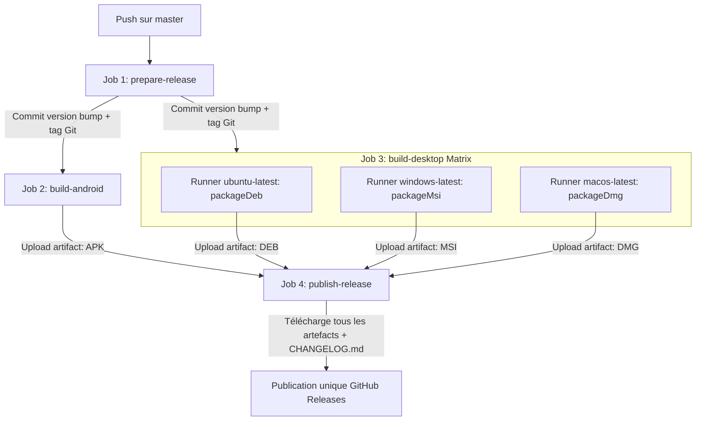

# Phase 0: Technical Research & Architecture Decisions

**Feature**: `018-desktop-multiplatform-releases`  
**Date**: 2026-11-11  

---

## 1. Empaquetage natif Desktop avec Compose Multiplatform

### Contexte & Problématique
Le projet Droidplane a été migré vers Kotlin Multiplatform et Compose Multiplatform (`org.jetbrains.compose` v1.7.3) avec une cible `jvm("desktop")` fonctionnelle dans `:app`. Actuellement, le bloc `compose.desktop.application` ne configure que la classe principale (`MainKt`) et la toolchain Java 21, sans bloc `nativeDistributions`. L'objectif est de produire des packages installables et distribuables pour Windows, Linux et macOS.

### Décision
Configurer le bloc `nativeDistributions` dans `app/build.gradle.kts` :
- **Formats cibles retenus** :
  - **Linux** : Paquet Debian (`TargetFormat.Deb`).
  - **Windows** : Installateur Windows (`TargetFormat.Msi`).
  - **macOS** : Image disque Apple (`TargetFormat.Dmg`).
- **Métadonnées applicatives** :
  - `packageName = "Droidplane"`
  - `packageVersion = appVersionName` (synchronisé avec la version Android `1.0.X`)
  - `description = "Droidplane Mind Map Application"`
  - `vendor = "Droidplane"`
  - `copyright = "© 2026 Julien Quiévreux"`
  - `macOS { bundleID = "fr.julien.quievreux.droidplane2" }`
  - `windows { menuGroup = "Droidplane"; upgradeUuid = "a4c28f6d-74d1-4cb5-8292-1e96a40a5a22" }`
- **Tâches Gradle correspondantes** :
  - Par plateforme : `:app:packageDeb` (Linux), `:app:packageMsi` (Windows), `:app:packageDmg` (macOS).
  - Ou tâche contextuelle selon l'hôte : `:app:packageDistributionForCurrentOS`.

### Justification & Rationale
- `jpackage` (inclus dans le JDK 21 et piloté par Compose Multiplatform) génère des distributions natives autonomes embarquant leur propre runtime Java optimisé, éliminant tout prérequis de JRE pour l'utilisateur final.
- Les formats `.msi`, `.dmg` et `.deb` sont les standards natifs les plus répandus et les plus simples à installer pour chaque OS.
- Le nommage des fichiers générés par Compose suit directement `packageName-packageVersion.extension` (ex: `Droidplane-1.0.40.deb`, `Droidplane-1.0.40.msi`, `Droidplane-1.0.40.dmg`), ce qui garantit clarté et absence de collision.

### Alternatives considérées
- *Archives ZIP / tar.gz génériques (`app/build/compose/binaries/main/app`)* : Bien que portables, elles obligent l'utilisateur à extraire manuellement et chercher le script exécutable dans un sous-dossier, ce qui dégrade l'expérience utilisateur par rapport à un installeur ou image disque native (.msi, .dmg, .deb).
- *Cross-compilation depuis un seul runner Linux* : `jpackage` n'est pas un cross-compilateur ; il dépend des outils natifs de l'OS hôte (`WiX` pour MSI sous Windows, `hdiutil` sous macOS, `dpkg`/`fakeroot` sous Linux). L'exécution doit donc s'appuyer sur des environnements d'exécution dédiés par système.

---

## 2. Orchestration CI/CD GitHub Actions Multi-OS

### Contexte & Problématique
Le workflow actuel `.github/workflows/android_release.yml` s'exécute sur un seul job `build-and-release` sous `ubuntu-latest`. Il incrémente la version via `scripts/bump-version.sh`, génère le changelog, compile l'APK Android et publie la release. Pour intégrer Windows, Linux et macOS sans complexifier inutilement le déclenchement, nous devons concevoir une orchestration multi-jobs distribuée.

### Décision
Restructurer le pipeline de release GitHub Actions en 4 étapes modulaires coordonnées :

1. **Job `prepare-release` (ubuntu-latest)** :
   - Auto-incrémente la version via `scripts/bump-version.sh`.
   - Génère le changelog avec `git-cliff`.
   - Committe `app/build.gradle.kts` avec `[skip ci]`, crée et pousse le tag `v${APP_VERSION_NAME}`.
   - Sauvegarde le changelog et expose `version_name` en sortie du job (`outputs.version_name`).
2. **Job `build-android` (ubuntu-latest)** :
   - Dépend de `prepare-release`.
   - Récupère le commit tagué, restaure le keystore et exécute les tests unitaires.
   - Compile l'APK release signé via `./gradlew assembleRelease --no-daemon`.
   - Téléverse l'APK comme artefact de workflow (`actions/upload-artifact@v4`).
3. **Job `build-desktop` (Matrix multi-OS)** :
   - Dépend de `prepare-release`.
   - Matrice :
     - `os: ubuntu-latest`, `task: :app:packageDeb`, livrable: `*.deb`
     - `os: windows-latest`, `task: :app:packageMsi`, livrable: `*.msi`
     - `os: macos-latest`, `task: :app:packageDmg`, livrable: `*.dmg`
   - Exécute Gradle avec JDK 21 et téléverse l'artefact de chaque plateforme.
4. **Job `publish-release` (ubuntu-latest)** :
   - Dépend de `[build-android, build-desktop]`.
   - Télécharge l'ensemble des artefacts (APK + DEB + MSI + DMG + CHANGELOG).
   - Crée la release GitHub avec `softprops/action-gh-release@v2` en attachant tous les fichiers livrables d'un coup.

### Justification & Rationale
- La séparation en jobs avec dépendances explicites garantit que la version et le tag sont figés une seule fois avant la compilation de tous les artefacts.
- Les runners GitHub Actions standards (`windows-latest`, `macos-latest`, `ubuntu-latest`) intègrent déjà tous les outils requis (`WiX Toolset` sous Windows, `hdiutil` sous macOS, `dpkg`/`fakeroot` sous Ubuntu).
- Si l'un des jobs échoue, la release finale n'est pas publiée sous forme incomplète ou corrompue, respectant l'exigence de traçabilité et de robustesse.

### Alternatives considérées
- *Compiler les distributions desktop après la publication de la release en mettant à jour la release existante* : Risque de laisser une release partielle accessible aux utilisateurs pendant plusieurs minutes, ou d'avoir des notifications de mise à jour discordantes. La publication atomique en fin de chaîne est bien plus propre et sûre.
- *Faire tourner les builds desktop en local uniquement via un script bash* : Impossible de générer les installeurs Windows/Mac sur une machine de développement Linux sans machines virtuelles ou dual boot. La CI GitHub Actions est le garant multiplateforme idéal.

---

## 3. Synchronisation de la version applicative

### Décision
Conserver `scripts/bump-version.sh` comme unique source de vérité de l'incrémentation :
- Met à jour `val appVersionCode = X` et `val appVersionName = "1.0.X"` dans `app/build.gradle.kts`.
- Dans `app/build.gradle.kts`, `packageVersion = appVersionName` propage immédiatement le nouveau numéro de version aux distributions Desktop sans script additionnel.
- Le tag Git `v${APP_VERSION_NAME}` et le `CHANGELOG.md` généré par `git-cliff` s'alignent automatiquement.
