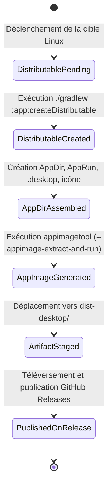

# Phase 1: Data Model & AppImage Packaging Schema

**Feature**: `019-linux-appimage-release`  
**Date**: 2026-11-11  

---

## 1. Modèle de Données et Entités

### AppImageDistribution (Livrable universel Linux)
Représente le fichier binaire exécutable autonome généré pour l'environnement Linux x86_64.

| Propriété | Type | Description | Règles de validation |
|---|---|---|---|
| `file_name` | String | Nom du fichier (ex: `Droidplane-1.0.40-x86_64.AppImage`) | Doit correspondre au pattern `Droidplane-<version>-x86_64.AppImage`. |
| `architecture` | String | Architecture CPU cible | Fixé à `x86_64` (Linux 64-bit). |
| `format` | Enum | Format d'empaquetage | `AppImage` (Type 2 SquashFS). |
| `version` | String | Version de l'application | Conforme au SemVer `appVersionName` (ex: `1.0.40`). |
| `entry_point` | String | Script de démarrage interne | `AppRun` pointant vers `bin/Droidplane`. |
| `desktop_entry` | DesktopEntry | Fichier de métadonnées FreeDesktop | Fichier `droidplane.desktop` valide. |
| `icon` | String | Icône applicative | Fichier PNG de résolution standard (`droidplane.png`). |

---

### DesktopEntry (Fichier de bureau FreeDesktop)
Définit les métadonnées de bureau requises par la spécification AppImage et FreeDesktop.

| Clé INI | Valeur type | Description |
|---|---|---|
| `Type` | `Application` | Type d'élément de bureau |
| `Name` | `Droidplane` | Nom affiché dans le lanceur d'applications |
| `Exec` | `Droidplane` | Nom de l'exécutable (ou `AppRun`) |
| `Icon` | `droidplane` | Nom du fichier icône sans extension |
| `Comment` | `Freeplane Mind Map Application` | Description courte du programme |
| `Categories` | `Office;FlowChart;` | Catégories FreeDesktop de classification |
| `Terminal` | `false` | Ne lance pas de console texte séparée |

---

## 2. Structure interne de l'AppDir

```text
AppDir/
├── AppRun                  # Script d'exécution (symlink ou script shell exécutable)
├── droidplane.desktop      # Métadonnées FreeDesktop
├── droidplane.png          # Icône racine de l'application
├── .DirIcon                # Symlink vers droidplane.png pour les gestionnaires de fichiers
├── bin/
│   └── Droidplane          # Binaire natif lanceur jpackage
└── lib/
    ├── app/                # JARs de l'application Droidplane et dépendances
    ├── runtime/            # JRE Java 21 modulaire embarqué
    ├── libapplauncher.so   # Bibliothèque dynamique jpackage
    └── Droidplane.png      # Icône source
```

---

## 3. États de l'Empaquetage AppImage


